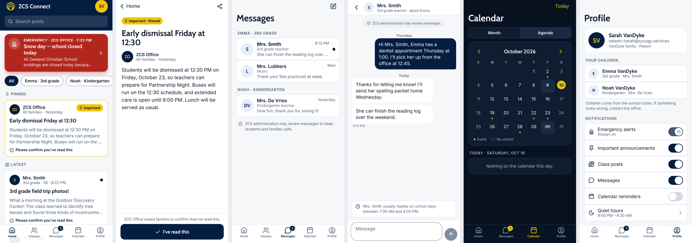

# ZCS Connect

One trusted channel between Zeeland Christian School and its families: a free iOS and Android app for
parents and teachers, and a web console for the office, principals and admins.



## What's here

| Path | What | Stack |
| --- | --- | --- |
| `apps/mobile` | Parent + teacher app (one app, context switcher) | Expo SDK 57, Expo Router, TanStack Query (offline cache), TypeScript |
| `apps/console` | Staff web console | Next.js 16, Tailwind v4 |
| `packages/core` | Shared types, typed RPC client, formatting, roster parsing | TypeScript, Vitest |
| `supabase/` | Schema, row-level security, RPCs, delivery worker, demo seed, permission tests | Postgres 17, pgmq, pg_cron, Edge Functions (Deno) |
| `docs/` | Spec, launch checklist, screenshots | |

## Run it

```bash
pnpm install
pnpm dev:mobile     # Expo dev server
pnpm dev:console    # http://localhost:3000
pnpm check          # typecheck + tests, all workspaces
```

Both apps point at the ZCS Supabase project by default (the publishable key is safe to ship; every
permission is enforced in the database).

## Docs

- [`docs/SPEC.md`](docs/SPEC.md): requirements and decisions
- [`docs/LAUNCH.md`](docs/LAUNCH.md): what's left to configure before the stores, step by step
- [`supabase/README.md`](supabase/README.md): data model, permissions and delivery
- [`CLAUDE.md`](CLAUDE.md): working rules for Claude Code

## Demo accounts

The demo school is fictional. Sign in with an email code to `rakesh+sarah@`, `rakesh+jen@` (teacher and
parent), `rakesh+principal@`, `rakesh+office@`, `rakesh+admin@` or `rakesh+review@` at syzygy.services. Remove
the demo data before launch with `select private.remove_demo_data();`.
